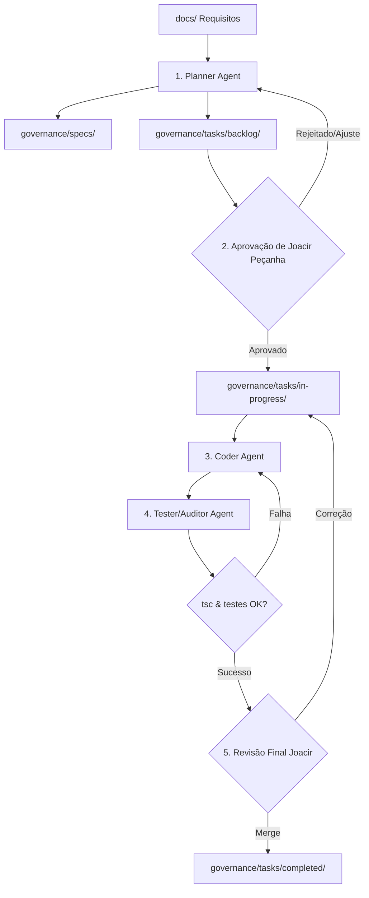

# Fluxo Operacional do Orquestrador — FieldOps

Este documento define o procedimento de orquestração para executar tarefas no FieldOps usando Spec-Driven Development (SDD).

---

## 1. Visão Geral do Ciclo



---

## 2. Passo a Passo Operacional

### Etapa 1: Ingestão e Planejamento (Planner Agent)
1. O usuário solicita uma nova funcionalidade ou melhoria com base em `docs/`.
2. O **Planner Agent**:
   - Localiza os requisitos correspondentes em `docs/`.
   - Verifica se já existe uma especificação técnica em `governance/specs/`. Se não existir, gera `SPEC-XXX.md`.
   - Gera a tarefa no template `governance/templates/task-template.md` e salva em `governance/tasks/backlog/TASK-XXX.md`.
   - Notifica Joacir Peçanha para avaliação.

### Etapa 2: Autorização e Entrada em Desenvolvimento (Joacir Peçanha)
1. Joacir Peçanha lê a tarefa em `governance/tasks/backlog/TASK-XXX.md`.
2. Confirma os requisitos, arquivos impactados e critérios de aceitação.
3. Move o arquivo para:
   ```
   governance/tasks/in-progress/TASK-XXX.md
   ```
4. Define o status como `IN_PROGRESS`.

### Etapa 3: Execução e Codificação (Coder Agent)
1. O **Coder Agent** inicia a sessão lendo obrigatoriamente:
   - `AGENTS.md`
   - `governance/tasks/in-progress/TASK-XXX.md`
   - A especificação referenciada em `governance/specs/`
2. O agente executa os passos descritos, respeitando os arquivos declarados.
3. Nenhum arquivo fora do escopo deve ser modificado.

### Etapa 4: Auditoria de Guardrails (Tester/Auditor Agent)
1. O agente executa a validação de tipagem estática:
   ```powershell
   cd c:\Users\Joacir\Desktop\field-ops\mobile
   npx tsc --noEmit
   ```
2. Executa a suite de testes unitários relevante.
3. Se houver qualquer falha ou regressão, o erro é corrigido imediatamente.
4. O agente preenche a seção de *Registro de Execução* no `TASK-XXX.md` com evidências e atualiza o status para `IN_REVIEW`.

### Etapa 5: Aprovação Final e Conclusão (Joacir Peçanha)
1. Joacir Peçanha analisa o diff das alterações e as evidências de teste.
2. Com a aprovação concluída:
   - A tarefa é movida para:
     ```
     governance/tasks/completed/TASK-XXX.md
     ```
   - O status é atualizado para `DONE`.
   - O branch de feature pode ser integrado via Pull Request.
